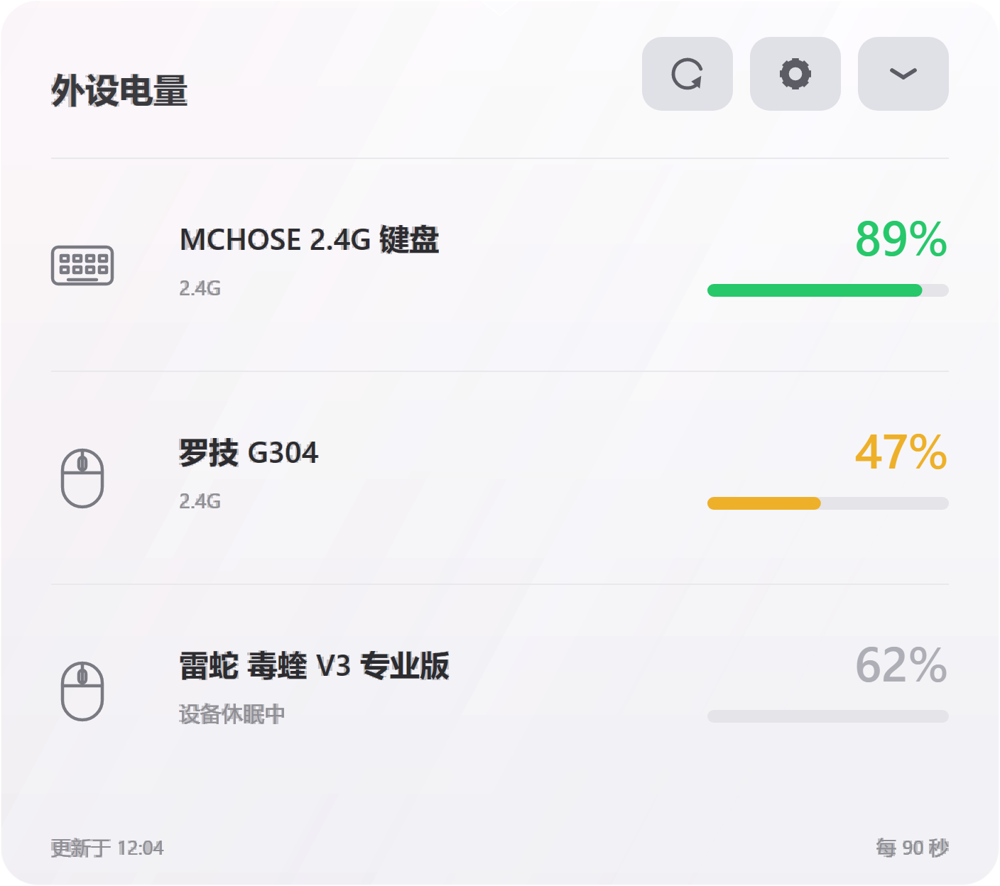
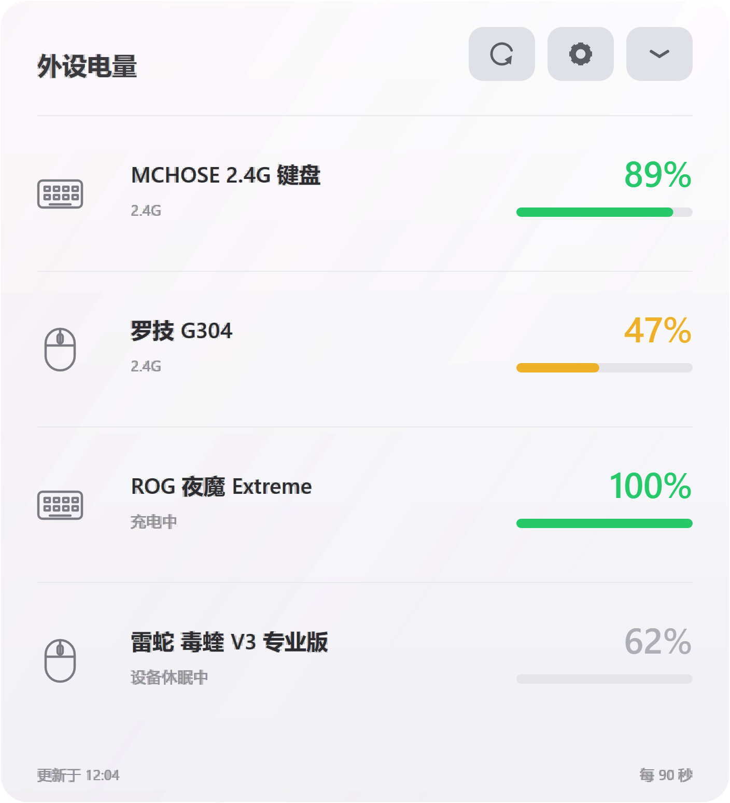
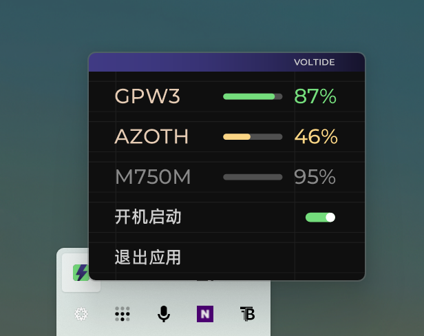

<p align="center">
  
</p>

<h1 align="center">Periphora</h1>

<p align="center">
  
  
  
</p>

一款轻量的托盘工具，在一块面板中显示 2.4G 无线外设（键盘、鼠标、耳机）的电量，无需安装任何厂商软件。

Periphora 是 [Voltide](https://github.com/sdparklab/Voltide) 的跨平台分支：协议解析与界面版式沿用上游，HID 后端被拆成 Windows 与 Linux 两套实现，界面在 Linux 上用 Skia 重绘，视觉与原版一致。**Windows 版行为不变，Linux 版为本次新增。**



*三台设备：89% 放电中、47% 中等电量，以及一台休眠设备保留着最后一次读数。*



*四台设备——超过三台时，卡片行可用鼠标滚轮横向翻阅。*

> 面板截图取自 Linux ARM64 构建（Avalonia + Skia 渲染，2 倍分辨率），与 Windows 版版式一致。托盘菜单那张是 Windows 版截图——Linux 下菜单由桌面环境绘制，外观随系统主题。

## 下载

| 平台 | 文件 | 体积 | 说明 |
|---|---|---|---|
| Windows 10 / 11 | `Periphora.exe` | 149 KB | 单文件，依赖系统自带的 .NET Framework 4.8 |
| Linux ARM64（deb） | `periphora_1.1.0_arm64.deb` | 37 MB | UOS 20 / Deepin / Debian 系，自带 udev 规则与桌面项 |
| Linux ARM64（通用） | `Periphora-linux-arm64.tar.gz` | 37 MB | 自包含 .NET 8，解压即用，附 `install.sh` |

**为什么 exe 只有 149 KB，Linux 包却有 37 MB？** 两者不是一回事：exe 里只有程序本身，运行时由 Windows 自带的 .NET Framework 4.8 提供；Linux 包必须自带整套运行时与图形栈，因为 UOS / 麒麟的软件源里没有 .NET 8，做成「依赖系统 dotnet」的包等于装完无法启动。解压后 95.9 MB，gzip 后 37 MB，构成为托管运行时 60.2 MB、原生 `.so`（Skia / HarfBuzz / CLR）26.1 MB、Avalonia 8.4 MB。体积全部花在运行时上，程序自身不到 200 KB。

已在 **UOS 20 + Kirin 9000C（aarch64）** 上完成构建与离屏渲染验证；外设实测请以你自己的设备为准，跑 `Periphora --test` 可以看到实际识别到了什么。

## 功能

- **一块面板容纳全部设备。** 卡片自动排布并居中；设备接入即出现。超过三台时，卡片行可用鼠标滚轮横向翻阅。
- **电量条。** 大号百分比下面是一条细进度条，随电量填充；面板每次打开会重放一次填充动画。
- **三档配色。** 50% 及以上为绿色，20% 至 49% 为黄色，20% 以下为红色。百分比与进度条同步变色。
- **准确的休眠状态。** 曾经上报过的设备在休眠时保留最后一次读数并变灰——一台睡着的鼠标仍然能提供信息。
- **动一下就更新。** 设备从休眠被唤醒时立刻重新读数，而不是等下一个轮询周期。Windows 靠 Raw Input 全局输入事件，Linux 靠对接收器输入节点的 `poll()`；只在空闲后的第一下动作触发，并带 8 秒冷却，避免把接收器问烦（问太勤它会停止应答）。
- **可调刷新间隔。** 15 / 30 / 90 秒三档，默认 90 秒，设置写入配置文件并在下次启动时恢复。Linux 下点面板右上角齿轮循环切换（也可在托盘菜单里直接选），Windows 下是面板底部的三个选项。
- **托盘集成。** 左键打开面板，右键菜单列出每台设备及其当前电量。
- **开机自启。** 可选，在托盘菜单中切换。
- **跨平台同一套协议。** 罗技 HID++、迈丛 20 字节帧、ROG Omni 双通道等协议代码在两个平台上完全共用。

## Linux 安装

### 方式一：deb 包

```bash
sudo dpkg -i periphora_1.1.0_arm64.deb
```

装到 `/opt/periphora`，同时安装 `/usr/share/applications/periphora.desktop` 与 `99-periphora-hidraw.rules`。启动后在应用菜单里找「外设电量」。

### 方式二：tar.gz

```bash
tar -xzf Periphora-linux-arm64.tar.gz -C ~/
cd ~/Periphora-linux-arm64
sudo ./install.sh      # 只做一件事：安装 hidraw udev 规则
./Periphora
```

### 权限说明

Linux 下读写 `/dev/hidraw*` 需要权限。自带规则按厂商号放行并打上 `TAG+="uaccess"`，**登录桌面的普通用户即可使用，不需要 root，也不需要 `sudo` 常驻**：

```
ACTION=="add|change", SUBSYSTEM=="hidraw", ATTRS{idVendor}=="046d", TAG+="uaccess", MODE="0660"
```

装完规则后如果接收器仍被拒绝，把接收器拔下来重插一次（触发 udev 重新匹配）。

### 诊断

面板不显示设备时，先跑自检：

```bash
Periphora --test
```

如果数值更新慢（要等五分钟、或者必须点一下面板才刷），可以单独验证唤醒监听。Windows 下：

```powershell
Periphora-Test.exe --rawtest
```

它会打印 `raw input sink : installed / FAILED`，然后在 6 秒内统计收到的输入报文数。`FAILED` 或计数为 0 说明监听没生效，程序会退回纯定时轮询——功能不丢，只是不能「动一下就更新」。

Linux 下看日志里的一行：

```bash
grep "activity watcher" ~/.config/Periphora/periphora-linux.log
```

`watching N input node(s)` 中 N 为 0 表示没有找到可监听的输入集合（通常是 udev 规则没生效），同样只会退回定时轮询。

输出包含架构、`/dev/hidraw*` 列表、以及每个适配器对各集合的匹配结果（含原始报文的十六进制）。把这个输出贴到 Issue 里，基本就能定位是设备没被枚举、还是协议没有应答。

### 配置文件位置

| 内容 | 路径 |
|---|---|
| 设置（刷新间隔等） | `$XDG_CONFIG_HOME/Periphora/settings.json`，默认 `~/.config/Periphora/settings.json` |
| 开机自启 | `$XDG_CONFIG_HOME/autostart/periphora.desktop` |
| 运行日志 | `$XDG_CONFIG_HOME/Periphora/periphora-linux.log` |

托盘图标走 StatusNotifierItem / AppIndicator。若桌面没有托盘宿主（部分精简版 UOS 环境），关闭按钮会直接退出程序而不是隐藏窗口，避免出现「关不掉」的情况。

## 当前已支持

以下设备均在上游 Windows 版真实硬件上验证过。Linux 版沿用同一套匹配规则与帧格式，但**尚未在真机上逐型号回归**。

| 品牌 | 设备 | 匹配 | 协议 |
|---|---|---|---|
| 罗技 Logitech | G304 / GPW3 / M750M / G102 / Unifying | VID `046D` | HID++ 2.0 |
| 迈丛 MCHOSE | K99 v2、G75 Pro | `3554:FA09` | 20 字节帧 |
| 迈丛 MCHOSE | Z75S | `258A:01BB` | 20 字节帧 |
| 迈丛 MCHOSE | K7 V2 Ultra+ | `3837:1014` | 64 字节 |
| 迈丛 MCHOSE | A5 V3 | VID `3837` | 65 字节 Feature |
| 迈丛 MCHOSE | A7 Ultra | VID `5253` | 厂商自定义 |
| 迈丛 MCHOSE | V9 Turbo+（耳机） | — | 厂商自定义 |
| ROG | AZOTH EXTREME（夜魔 Extreme） | `0B05:1ACE` | 64 字节帧；Omni 键鼠分离（实验性） |
| ROG | Delta II、Pelta（耳机） | VID `0B05` | 64 字节，0xFF00 |
| 雷蛇 Razer | 毒蝰、炼狱蝰蛇、巴塞利斯蛇等 24 款无线鼠标 | VID `1532` | 91 字节 Feature |
| 雷蛇 Razer | 旋风黑鲨 V2 专业版 | `1532:0555` | 64 字节音频通道 |
| ATK | A9 Air 大师+ / F1 V3 Ultimate+ | `373B:1278` | 17 字节，和校验 0x4D |
| ATK | N9 V2 Ultimate（耳机） | `373B:1262` | 64 字节，report 0x55 |
| VXE | R1 | `373B:10C9` | 17 字节（Compx 方案） |
| 泰度 TAIDU | TSG809 | VID `A8A5` | 厂商自定义 |
| IMECOO | P1 | `3554:FB34` | 17 字节 |
| 前行者 EWEADN | S9 Pro | `372E:103D` | 厂商自定义 |
| 前行者 EWEADN | A5 Pro | `258A:0138` | 520 字节 Feature |
| XIBERIA | T7（耳机） | `36F9:F008` | 64 字节 |
| CROCIRIS | X7 | `36F9:AA20` | 厂商自定义 |
| 雷柏 RAPOO | VT3S | `24AE:1411` | 64 字节 |
| 达尔优 DAREU | A950 AIR V2 | — | 厂商自定义 |
| Sony | PS5 / PS5 EDGE | `054C:0CE6` / `0DF2` | HID |
| Xbox | Series X\|S、8BitDo 等 XInput 手柄 | 槽位 0–3 | 四档电量（**仅 Windows**） |

> 上述设备的适配由上游社区的贡献者逆向并验证：
> [@RealRayTan](https://github.com/RealRayTan)（PS5）、
> [@Yim-7](https://github.com/Yim-7)（XIBERIA T7、CROCIRIS X7）、
> [@CLR0512](https://github.com/CLR0512)（VXE R1）、
> [@waitter-01](https://github.com/waitter-01)（MCHOSE V9、DAREU A950）、
> [@HSOTrany80](https://github.com/HSOTrany80)（MCHOSE A7）、
> [@study-yang](https://github.com/study-yang)（EWEADN S9 Pro）、
> [@LinWeiLong](https://github.com/LinWeiLong)（雷柏 VT3S）、
> [@yuanmie](https://github.com/yuanmie)（EWEADN A5 Pro、Z75S）、
> [@znc15](https://github.com/znc15)（ROG Omni 键鼠分离）、
> [@WeiqiaoCode](https://github.com/WeiqiaoCode)（刷新间隔崩溃修复）。
>
> 早期贡献者：[yiwluoq](https://github.com/yiwluoq)（ATK）、[Mor16rty](https://github.com/Mor16rty)（IMECOO、Xbox）、[whitzard0421](https://github.com/whitzard0421)（K7 V2 Ultra+）、[koobzx](https://github.com/koobzx)（A5 V3）、[ptaritsu](https://github.com/ptaritsu)（TAIDU）、[Cantrarella](https://github.com/Cantrarella)（ROG Delta II / Pelta）。
>
> 雷蛇与狼蛛协议的逆向由 B 站网友 木兮丶念旧 完成并分享，一并致谢。

### 如何添加新设备

每个品牌都是一个自包含的适配器，添加新设备不需要触碰界面，也不需要写两遍——同一份 provider 代码在 Windows 走 `setupapi`，在 Linux 走 `hidraw`，差异全部收在 `HidSession` 里。

```csharp
public interface IDeviceProvider
{
    string Name { get; }
    List<DeviceInfo> Discover(List<HidDeviceInfo> catalog);   // catalog 由 DeviceManager 统一枚举
    DeviceReading Read(DeviceInfo device); // 发送查询，解析回复
}
```

添加步骤：

1. 新建 `src/Providers/YourBrandProvider.cs`，实现 `IDeviceProvider`。
2. 在 `src/Core/DeviceManager.cs` 中与现有适配器一并注册。
3. 重新编译。

`Discover()` 会收到系统暴露的全部 HID 集合。写 Linux 分支时注意两点：

- 不要解析设备路径字符串（Windows 用 `&mi_02&` 之类，Linux 是 `/dev/hidraw3`）。用 `HidDeviceInfo.InterfaceNumber`、`PhysicalId`、`UsagePage` 这些平台无关字段。
- `SetFeature` / `GetFeature` 走 `HIDIOCSFEATURE` / `HIDIOCGFEATURE`；`SetOutputReport` 优先 `HIDIOCSOUTPUT`，内核不支持时才回退到 `write()`。这两类报表不要混用。

若厂商协议未公开，可以通过抓包还原：运行官方工具，用 [USBPcap](https://desowin.org/usbpcap/)（Windows）或 `usbmon`（Linux）记录流量，定位返回百分比的那一次请求。

## 使用方法

两个平台的操作基本一致：

1. 启动后，面板会打开一次，之后常驻托盘。
2. 左键点击托盘图标打开面板，右键查看设备列表。
3. 调整刷新间隔与开机自启：Windows 在面板底部与托盘菜单里，Linux 在面板右上角齿轮与托盘菜单里。

无需安装、无后台服务、无需管理员权限。



*Windows 版的托盘菜单：列出每台设备及其当前电量，并提供刷新间隔与开机自启开关。*

### 如何理解面板

| 显示状态 | 含义 |
|---|---|
| 彩色百分比 + 已填充的进度条 | 设备在线并正常上报 |
| 灰色百分比 + 空的进度条，副标题「设备休眠中」 | 设备休眠；所示数值为最后一次读数 |
| `--` 与「设备休眠中」，进度条为空 | 接收器在，但设备从未上报过 |

第一张截图里第三行就是第二种情况：雷蛇鼠标已经休眠，卡片仍显示 62% 并整体变灰。

### 设置

- **刷新间隔** —— `15s / 30s / 90s` 三档，默认 90 秒，写入配置文件后长期生效。面板隐藏到托盘时刷新放慢至 5 分钟。
  - **Linux**：点右上角齿轮在 15 → 30 → 90 之间循环，面板右下角显示当前值（`每 90 秒`），切换后顶部弹出提示；也可以从托盘右键菜单直接选。
  - **Windows**：面板底部直接列出三个选项。
- **收起面板** —— 右上角箭头把面板收回托盘；若桌面没有托盘宿主，点击直接退出进程。
- **开机自启** —— 托盘菜单中的开关。Windows 写当前用户启动项；Linux 写 `~/.config/autostart/periphora.desktop`。均无需提权。

## 系统要求

**Windows**：Windows 10 1903 或更高版本 / Windows 11，.NET Framework 4.8（系统已内置）。

**Linux**：aarch64，glibc 2.28 以上的发行版。已在 UOS 20（Kirin 9000C）上完成构建验证，Debian 10+ / Ubuntu 20.04+ / Deepin 20+ 理论上同样可用。需要以下之一的托盘宿主：

- 完整的桌面环境（DDE、UKUI、GNOME + AppIndicator 扩展、KDE）
- 或任意支持 StatusNotifierItem 的 panel

自包含包不依赖系统 dotnet，但需要系统中存在以下本地库（桌面版发行版默认都有）：

```bash
libx11-6 libice6 libsm6 libfontconfig1 libfreetype6
```

缺字体时中文会显示为方框，建议装一个 `fonts-noto-cjk` 或 `fonts-wqy-microhei`。

安装后磁盘占用约 96 MB —— 其中程序本体不到 200 KB，其余是自带的 .NET 8 运行时与 Skia 图形栈。若你的机器已经有 .NET 8，可以自己从源码用 `--self-contained false` 发布一个几 MB 的 framework-dependent 版本。

## 构建

### Windows

```powershell
# 编译（使用 Windows 自带的 C# 编译器，无需装 SDK）
powershell -ExecutionPolicy Bypass -File build.ps1

# 生成可分发的单文件版本
powershell -ExecutionPolicy Bypass -File pack.ps1 -Target dist
```

三款字体以清单资源的形式嵌入可执行文件，因此产物为单个文件。

### Linux ARM64

需要 .NET 8 SDK。脚本会优先使用项目内的 `.tools/dotnet`，找不到再回退到 PATH 上的 `dotnet`。

```bash
./linux/build-linux-arm64.sh
```

产物在 `dist/`：`Periphora-linux-arm64/`（目录）、`Periphora-linux-arm64.tar.gz`、`periphora_1.1.0_arm64.deb`。打包脚本 `linux/packaging/package.py` 手工构造 ar 归档，不依赖 `dpkg-deb`，因此在 Windows 或 x86 机器上也能交叉产出可用的 deb。

在 x86 机器上交叉编译时，`-r linux-arm64` 需要能拿到运行时包，这通常意味着已安装对应的 runtime pack 或有网络。`InvariantGlobalization=true` 已开启，避免依赖目标机的 ICU。

### 重新生成截图

`docs/` 下的面板图不是手工截的，而是由界面自己渲染，不需要真机和外设：

```bash
dotnet publish linux/Periphora.Linux.csproj -c Release -r win-x64 --self-contained false -o out/shot

PERIPHORA_SHOT=/tmp/panel.png  PERIPHORA_SHOT_SCALE=2 out/shot/Periphora --demo=3
PERIPHORA_SHOT=/tmp/panel4.png PERIPHORA_SHOT_SCALE=2 out/shot/Periphora --demo=4
```

`--demo` 接受 `2` / `3` / `4` / `empty`，用合成读数渲染对应场景（第三台故意设为休眠且此前上报过 62%）。`PERIPHORA_SHOT_SCALE=2` 输出 2 倍图，适配高 DPI 显示。托盘菜单那张只能手工截。

## 协议说明

这些协议均非厂商公开。各帧格式已写在对应适配器的文件头注释中。

- **罗技** —— HID++ 2.0。特性 `0x1004` 的功能 1 返回百分比；老款接收器回退到特性 `0x1000`。
- **迈丛** —— 报告 `0x13` 上的 20 字节帧。命令 `0x4A`，第 5 字节为百分比，第 19 字节为前序字节的模 256 校验和。
- **ROG** —— 向接收器的厂商集合（用途页 `0xFF00`）写入 64 字节帧 `02 12 01`。回复的第 6 字节为百分比，第 10 字节为设备上配置的低电量阈值。

有一处值得记录的陷阱：罗技 `0x1004` 的**功能 0** 返回的是电压而非电量——设备空闲时它恒定为 3.85 V，与真实电量无关。返回百分比的是功能 1（`0x1E`）。早期版本读取功能 0，这正是电量显示与 G HUB 不一致的原因。

## 平台差异与已知限制

**平台差异**

- **唤醒检测的实现不同。** Windows 用 `RegisterRawInputDevices` 挂一个 `RIDEV_INPUTSINK` 消息窗口，不打开设备、不与 G HUB 争句柄；Linux 对接收器的 Generic Desktop 集合（用途页 `0x01`）开非阻塞 `poll()`，设备一动节点就变可读。Linux 侧只监听输入集合，厂商集合上正在被 provider 读取的节点会被跳过——HID++ 的回复本身就是输入报文，多一个读者会把应答吞掉。两种监听初始化失败时都自动退回纯定时轮询。
- **XInput 手柄仅 Windows。** Linux 版不注册 XInput 适配器；Xbox 手柄在 Linux 下走内核 `xpad` 驱动，不提供电量通道。
- **报告长度归一化。** 无 report id 的 hidraw 设备读取时会少一个字节，Linux 后端在首位补 `0x00`，让 provider 内部的偏移约定与 Windows 保持一致。
- **MCHOSE K7 的接口判定。** Windows 解析路径里的 `&mi_02&`，Linux 改用 `InterfaceNumber == 2`。
- **ROG Omni 三通道判定。** Windows 解析路径后缀，Linux 按集合的 `UsagePage`（`0xFF02` 键盘 / `0xFF00` 鼠标 / `0xFF01` 接收器）区分。

**通用限制**

- 从未上报过电量的设备在休眠时无法被查询唤醒，将显示 `--`，直至被使用。
- **ROG Omni 键鼠分离为实验性功能**：已实现配对表读取与按报告 ID 分通道查询。若接收器配对表无应答，会回退到只读键盘通道。
- 共享同一接收器的无线设备通过接收器上报，而非各自独立上报。
- 同品牌但不同型号的设备会被识别为现有型号。适配层按厂商与接口特征匹配，尚未区分具体型号。
- 迈丛与狼蛛共用 USB 标识（`3554:FA09`）。目前仅适配迈丛的查询协议，狼蛛键盘可能被识别为迈丛型号，读数也可能不正确。

## 上游与许可

MIT，详见 [LICENSE](LICENSE)。

原项目 [Voltide](https://github.com/sdparklab/Voltide) 由 [Joko](https://github.com/sdparklab) 设计与开发，Windows 端的全部设备适配、界面设计与协议逆向工作都来自他和上游社区。Periphora 在其基础上重做了 HID 后端与界面渲染层，以支持 Linux ARM64。若你只用 Windows，直接用上游版本即可。
